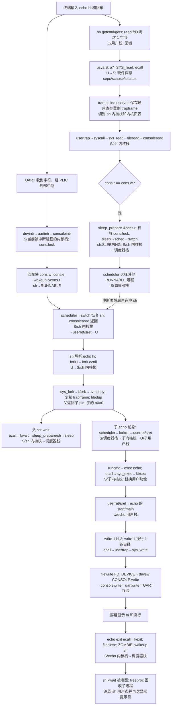

# Lab0 材料一：Shell 执行 `echo hi` 的全系统控制流图

**观察范围**：从用户在终端输入 `echo hi` 并按回车，到屏幕出现 `hi` 与换行、子进程退出、父进程完成 `wait`。本图依据本地 `xv6-riscv` 参考树；它不是当前 Lab1 裸机内核的运行轨迹。

**图例**：`U/用户栈`=用户态及当前进程用户栈；`S/进程内核栈`=S 态及当前进程内核栈；`S/调度器栈`=S 态及当前 CPU 调度器专用栈。锁栏写该节点的关键持锁；`无`表示该节点不持有自旋锁，不能理解成整个函数从不加锁。启动时 M 态只用于配置和 `mret`，下列命令链发生在 U/S 态。

## 时序与边界标注

| 时序 | 当前执行体与关键调用 | 特权级／栈 | 持锁与状态变化 |
|---|---|---|---|
| 1 | `sh: getcmd→gets→read(0,&c,1)`；每次系统调用读取一个字符 | `U/sh 用户栈` → `S/sh 内核栈` | 用户态无自旋锁；陷入硬件只记 `sepc/scause/sstatus`，`uservec` 才逐个保存通用寄存器。 |
| 2 | `usertrap→syscall→sys_read→fileread→devsw[CONSOLE].read→consoleread` | `S/sh 内核栈` | `consoleread` 持 `cons.lock` 检查输入环形缓冲。空缓冲时登记 `&cons.r`，释放 `cons.lock`，再 `sleep→sched→swtch`；`sched` 切换时只持 `sh->lock`，并将 `sh` 置为 `SLEEPING`。 |
| 3 | 终端设备收到各字符；UART/PLIC 外部中断使当前 CPU 进 `kerneltrap` 或 `usertrap`，再经 `devintr→uartintr→consoleintr` | 被打断处若为 U 则 `uservec` 换至**被打断进程**内核栈；若为 S 则 `kernelvec` 留在其当前内核栈／调度器栈 | `consoleintr` 持 `cons.lock`；它会回显字符。回车时 `cons.w=cons.e` 并 `wakeup(&cons.r)`，短暂获得各 `p->lock`，把 sh 标为 `RUNNABLE`。 |
| 4 | 调度器再次选中 sh；`consoleread` 将字节拷给用户缓冲，读到换行返回。`usertrap→prepare_return→userret→sret` | `S/调度器栈` → `S/sh 内核栈` → `U/sh 用户栈` | `scheduler` 选进程时持该 `p->lock`，恢复后由进程侧释放；返回 U 前无自旋锁。 |
| 5 | sh 对非内建命令执行 `fork1`；`sys_fork→kfork` | `U/sh 用户栈` → `S/sh 内核栈` | `kfork` 复制页表和 `trapframe`，`filedup` 增文件引用计数；复制父 `ofile` 指针；设置子 `a0=0`，父得到子 PID。子标记 `RUNNABLE`。 |
| 6 | 父 sh 调用 `wait→sys_wait→kwait`；子由 `scheduler→forkret` 首次运行，回到用户态后 `runcmd` | 父：`S/sh 内核栈→调度器栈`；子：`调度器栈→S/子内核栈→U/子用户栈` | 父等待时持 `wait_lock` 扫描子进程；登记睡眠通道 `sh` 后先放 `wait_lock` 再睡。子第一次运行经 `forkret` 释放由 `scheduler` 带过来的 `p->lock`。 |
| 7 | 子 `exec("echo", argv)`：`sys_exec→kexec` 读取 ELF，建立新页表和栈，然后替换旧地址空间 | `U/子用户栈` → `S/子内核栈` → `U/echo 用户栈` | `exec` 保留 PID、父子关系、`ofile`、`cwd`，替换 `pagetable`、`sz`、入口 PC 和用户 SP；文件系统路径上短时持 inode 睡眠锁／日志事务。 |
| 8 | 当前树 `echo.c` 对 `hi` 调用一次 `write(1,"hi",2)`，随后另一次 `write(1,"\n",1)` | 各次 `U/echo 用户栈` → `S/echo 内核栈` | `sys_write→filewrite(FD_DEVICE)→consolewrite→uartwrite`。`uartwrite` 使用 **`tx_lock` 睡眠锁**串行输出，不持自旋锁睡眠；硬件暂忙则在 `&tx_chan` 睡眠，由 UART 发送中断唤醒。 |
| 9 | UART 驱动写 `THR`，终端显示 `hi\n`；echo `exit→kexit`，sh 的 `kwait` 回收它 | echo：`S/echo 内核栈→调度器栈`；sh：`S/sh 内核栈→U/sh 用户栈` | `kexit` 逐一 `fileclose`，唤醒 sh，设置 `ZOMBIE`；`kwait` 持 `wait_lock` 和子 `p->lock` 完成 `freeproc`，父重新显示提示符。 |

## 三处推演批注

1. **read 的阻塞边界**：`sleep_prepare` 与 `sleep` 分两步，期间 UART 中断可能先 `wakeup`。`wakeup` 清 `p->chan`，随后 `sleep()` 发现它为 0 就不真正睡下，避免丢失唤醒；sh 不会永远卡在 `read`。
2. **输出并非单次 `write(1,"hi\n",3)`**：此版本 `echo.c` 对参数与换行分开调用 `write`。图中把它们画成两次陷入，否则与源码不符。
3. **wait 与 exit 的竞态**：如果子在父进入 `wait` 前已退出，它保持 `ZOMBIE`；`kwait` 扫描时直接回收。若父先睡下，`kexit` 的 `wakeup(p->parent)` 再唤醒父，两条路径都成立。

**源码定位**：`/Users/wangjane/Desktop/xv6-riscv/user/sh.c`、`user/ulib.c`、`user/echo.c`、`user/usys.pl`、`kernel/trampoline.S`、`kernel/trap.c`、`kernel/syscall.c`、`kernel/sysfile.c`、`kernel/proc.c`、`kernel/console.c`、`kernel/uart.c`、`kernel/file.c`。
