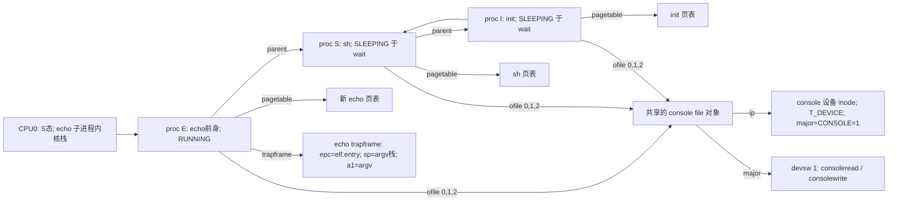

# Lab0 材料二：exec 完成后、echo 首条用户指令前的数据结构全景快照

**截面定义**：选单核的一条合法时序：sh `fork` 后先进入 `wait` 并睡眠，调度器随后运行子进程；子进程在 `kexec("echo", argv)` **刚提交新映像**（`p->pagetable = pagetable; p->sz = sz;`）且尚未执行 echo 首条用户指令的瞬间。此刻 CPU 仍在子进程的 `S` 态内核栈，稍后 `sys_exec` 返回、`prepare_return→userret→sret` 才进入 echo。PID 与物理页号取决于运行时分配，因此图中使用符号，不伪造固定数值。

## A. 进程表与引用全景



| `proc` | `state` / `parent` | `pagetable` / `sz` | `ofile[0..15]` |
|---|---|---|---|
| init (`I`) | `SLEEPING`，`parent=0`；本时序正等待 sh | `PT_init`；`sz_init` 为 init 映像大小，非 echo 大小 | 0、1、2 指向 console 的 `file` 对象 `F`；3–15 为 `0`，假定此时没有其他打开文件。 |
| sh (`S`) | `SLEEPING`，`parent=I`；`chan=S`（`kwait` 等 echo） | `PT_sh`；`sz_sh` 为 sh 的用户空间大小 | 0、1、2 指向 `F`；3–15 为 `0`（命令 `echo hi` 不重定向、不建管道）。 |
| echo 子进程 (`E`) | **`RUNNING`**，`parent=S`；尚在 `kexec` 的 S 态路径上 | `PT_echo_new`；`sz_echo=G+2×PGSIZE`，其中 `G=PGROUNDUP(最后一个 PT_LOAD 段结束 VA)`，`USERSTACK=1` | `kfork` 的 `filedup` 使 0、1、2 继续指向 `F`；`exec` 不清空文件描述符；3–15 为 `0`。 |

`proc` 是全局 `proc[NPROC]` 表；每条记录还含 `pid`、`kstack`、`trapframe`、`context`、`cwd`。`E` 的内核栈与 `trapframe` 是 `allocproc` 分配的；`kexec` 用新页表替换旧页表，但不换这个内核栈。`E->trapframe->epc=elf.entry`，`sp` 指向新用户栈中的参数区，`a1` 指向 `argv`；随后 `syscall()` 把返回的 `argc` 写入 `a0`。同一时刻只有该 CPU 上的 `E` 处于 `RUNNING`；多核情况下其他状态可能不同，本图固定单核时序。

## B. echo 用户页表的 Sv39 映射树

`MAXVA = 0x4000000000`，`PGSIZE = 0x1000`，所以 `TRAMPOLINE = 0x3ffffff000`，`TRAPFRAME = 0x3fffffe000`。以 `[起点,终点)` 表示区间。

```text
PT_echo_new  (Sv39 根页表，satp.PPN 指向物理根页)
├─ L2[PX(2,va)] → L1[PX(1,va)] → L0[PX(0,va)] → 低地址用户叶 PTE
│  ├─ ELF PT_LOAD 段页：各段 [ph.vaddr, PGROUNDUP(ph.vaddr+ph.memsz))
│  │  ├─ 代码页：V|R|X|U（若段仅可执行）；实际权限按 ELF ph.flags 转换
│  │  └─ 数据/BSS 页：V|R|W|U（若段可写）
│  ├─ [G, G+0x1000)       栈 guard 页：V|R|W，PTE_U=0
│  └─ [G+0x1000,G+0x2000) 用户栈：V|R|W|U，sp 位于此页
├─ 未映射空洞：(G+0x2000) ... 0x3fffffe000
│  └─ 堆：本截面尚未单独分配；后续 sbrk 从当前 sz 扩展，可能出现 V|R|W|U 的页
├─ L2/L1/L0 → [0x3fffffe000,0x3ffffff000) TRAPFRAME：V|R|W，PTE_U=0
└─ L2/L1/L0 → [0x3ffffff000,0x4000000000) TRAMPOLINE：V|R|X，PTE_U=0
```

| 区域 | 虚拟地址与物理对象 | 权限／解释 |
|---|---|---|
| 代码、只读数据及可写数据 | 由 `echo` ELF 的各个 `PT_LOAD` 的 `ph.vaddr/ph.memsz/ph.flags` 决定；不能凭源码猜固定边界 | `uvmalloc` 基础权限 `V|R|U`；段若有 `EXEC` 再加 `X`，若有 `WRITE` 再加 `W`。不同段的实际权限应按 ELF 标志逐一标。 |
| guard 页 | `[G,G+0x1000)`；物理页存在 | `uvmclear` **只清 PTE_U**，故不是完全未映射；用户访问触发异常，S 态仍可访问。 |
| 用户栈 | `[G+0x1000,G+0x2000)`；`USERSTACK=1` | `V|R|W|U`；`sp` 在该页，字符串与 `argv` 从高地址向低地址排布。 |
| 堆区 | `sz=G+0x2000` 以上的可扩展空间；本截面无独立堆页 | 不是把 guard 与用户栈之间误标成堆；后续 `sbrk` 才增长 `sz`，此版可能按需懒分配。 |
| trapframe | `[0x3fffffe000,0x3ffffff000)` → `E->trapframe` 物理页 | `V|R|W`，无 `U`；trampoline 代用户在 S 态保存/恢复寄存器。 |
| trampoline | `[0x3ffffff000,0x4000000000)` → 全进程共用 trampoline 代码物理页 | `V|R|X`，无 `U`；S 态陷入/返回路径用；**不随 fork 复制物理代码页**。 |

每一个有效叶 PTE 还包含物理页号 PPN；中间级 PTE 只有 `V` 并指向下一级页表页。`proc_pagetable` 在新页表上先映射 trampoline 和 trapframe；`kexec` 再映射 ELF 和栈；旧页表在提交后释放。图中 `sz` 是进程已使用用户地址空间的高水位，**不是整张页表的顶端**，因为 trapframe/trampoline 固定在接近 `MAXVA` 的高地址。

## C. 文件描述符、file 表与 inode 快照

```text
init.ofile[0] ─┐
init.ofile[1] ─┤
init.ofile[2] ─┤
sh.ofile[0..2] ├──> ftable.file F {type=FD_DEVICE, ref≈9,
echo.ofile[0..2]┘                     readable=1, writable=1,
                                      major=CONSOLE(1), ip=I_console}
                                           │                   │
                                           │ip                 └──> devsw[1]
                                           v                        read=consoleread
                              inode I_console {type=T_DEVICE,     write=consolewrite
                              major=1, minor=0, ref=...}
                                           │
                                           └──> consolewrite→uartwrite→UART0 THR
```

`init` 启动时 `open("console",O_RDWR)` 得到 fd 0，`dup(0)` 两次得到 1、2；sh 从 init 的 `fork` 继承同一 `F`，echo 从 sh 的 `fork` 再继承它。若只有这三个进程且均未另开文件，`F.ref=9`（三个进程各三个描述符）；它是一个**条件性快照值**，而不是 inode 的 `ref`。`F.ip` 指向磁盘文件系统中代表设备节点 `console` 的 inode；`FD_DEVICE` 写操作按 `major=1` 分派到 `devsw[1].write=consolewrite`，不是按普通文件偏移写入数据块。`cwd` 各自还引用根目录 inode，与 fd1 的设备 inode 不同。

## 推演批注与答辩点

1. **为什么 `exec` 后还能输出到 fd1？** `kexec` 只提交新用户映像和寄存器入口；`proc.ofile` 保留。`kfork` 早已对共享 `file` 调用 `filedup`。
2. **guard 页究竟“无效”还是“不可给用户访问”？** 此树 `uvmclear` 仅清 `PTE_U`，页仍有 `V|R|W`；“未映射 guard”是对本实现的不精确表述。
3. **子进程退出会泄漏 stdout 吗？** `kexit` 遍历 `ofile` 执行 `fileclose`，`F.ref` 按描述符递减；最后一个引用离开时才 `iput(F.ip)`。父进程 `wait` 回收的是 `proc` 与页表，文件引用在 `exit` 已处理。
4. **为何 trampoline 不复制物理页？** 所有进程的页表映射到同一只读可执行内核代码页；需要隔离的是每个进程自己的 trapframe 数据页。

**源码定位**：`/Users/wangjane/Desktop/xv6-riscv/kernel/proc.h`、`proc.c`、`exec.c`、`vm.c`、`memlayout.h`、`riscv.h`、`file.h`、`file.c`、`sysfile.c`、`console.c`、`param.h`、`/Users/wangjane/Desktop/xv6-riscv/user/init.c`。
