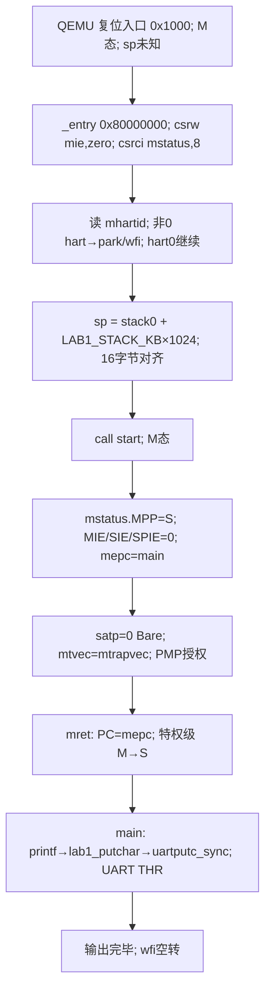

# Lab1 设计笔记：启动、特权级切换与串口输出

本笔记按当前工程的五个核心文件和学号参数撰写，供逐行讲解与复测使用。实际实现采用 `satp=0`（Bare）、单 hart 启动、UART 轮询输出；最终 banner 只输出一次。对预置的 `kernel.ld`、`riscv.h`、`types.h`、`memlayout.h`、`course_sid.h` 和 Makefile 的验收段均不作修改。

## 1. 从上电 PC 到内核地址

QEMU virt 复位后先执行位于 `0x1000` 的复位代码；`-bios none` 表示不加载外部 BIOS/固件，并不等于 CPU 从内核 C 函数直接开始。QEMU 的 `-kernel` 装载机制把本 ELF 的可装载段放到其链接所规定的 RAM 地址，最后跳到 `_entry`。虚拟机 RAM 起点为 `0x80000000`，而 `0x0` 区域不是供本内核放置代码的 RAM；链接脚本把 `BASE_ADDRESS` 设为 `0x80000000`，因此链接地址与本次加载地址一致。此处 `satp=0`，链接虚拟地址在启动早期也就是物理地址。

## 2. 启动时序图（寄存器与特权级）



`entry.S` 的 `csrw mie,zero` 清所有 M 态中断源使能，`csrci mstatus,8` 清 `MIE` 总开关；两步先于设置栈和控制寄存器，避免启动配置半完成时响应中断。`mhartid!=0` 的核进入 `park`，避免多核共用 `stack0`。`la sp,stack0` 取得数组低端，`li t0,LAB1_STACK_KB*1024` 再相加，栈向低地址生长，因此新 `sp` 指向末尾之后；本人的 `LAB1_STACK_KB=4`，容量为 4096 字节，基址及容量由 `entry.S` 与 `start.c` 的同一个宏保持一致。`call start` 将返回地址写 `ra`，而 `start` 等 C 函数用栈，所以设栈必须先于调用。

`start` 将 `mstatus.MPP` 改为 S、`mepc` 指向 `main`。`mret` 使用这两个寄存器完成 M→S 与 PC 跳转。`mret` 不执行 `SIE←SPIE`，后者属于 `sret`；本实验同时清 `SIE/SPIE`，始终不接收 S 态中断。`satp=0` 使用 Bare 模式，不建立恒等映射页表，因为 Lab1 所用地址即物理地址，Sv39 页表与分配器属于后续实验。M 态陷阱保留在 M 态，`mtvec` 指向 4 字节对齐的 `mtrapvec`；本轮没有正常的陷入路径。

PMP 必须允许 S 态取指、读写：`pmpaddr0=0x3fffffffffffff`，`pmpcfg0=0xf`。按规范 `pmpcfg0` 低字节的 `R/W/X` 均为 1、`L=0`，`A=01` 是 **TOR**；条目 0 的下界为 0，上界由 `pmpaddr0<<2` 给出，覆盖运行所需物理区。说明书把 `0xf` 注为 NAPOT，但编码按位解读为 TOR。删除 PMP 配置会令 S 态第一条取指触发 instruction access fault（cause=1），表现为黑屏。

## 3. 内核地址空间布局图

```text
物理地址 / Bare 下的同值地址
0x10000000       UART0 MMIO：THR偏移0、LSR偏移5（不属于RAM）
0x80000000       _entry；.text（代码，含 start/main/printf）
                  .rodata（格式字符串）
                  .data（已初始化数据；节流倒计数器初值为17）
                  .bss（stack0[LAB1_STACK_KB*1024]，16字节对齐）
                  stack0+4096 ← hart0 初始 sp；栈向低地址增长
kernel_end        链接脚本导出的内核尾部；后续实验分配物理页的起点
```

`kernel.ld` 依次排列 `.text/.rodata/.data/.bss`。它不提供可靠的 BSS 起止符号，因此 Lab1 不增加依赖 BSS 零初值的输出状态；节流倒计数器用非零初始化值放在 `.data`。`stack0` 只取地址、被栈写覆盖，不读取原有内容。函数入口 `sp` 满足 16 字节 ABI 对齐。

## 4. UART、协议与节流设计

`uartputc_sync(c)` 只负责硬件字节发射：以 `volatile` 反复读取 `UART0+5` 的 LSR bit5（THRE），为 1 才将 `c` 写入 `UART0+0` 的 THR。启动期无中断和时钟，故轮询是可执行方案，且仅 hart0 调用，不需要锁。协议、格式化和节流放在上层 `printf.c` 的 `lab1_putchar`；每发送一字节递减倒计数。输出满 `16 + COURSE_SID % 16 = 17` 个实际字节后执行 256 次 `nop`，然后重装倒计数；循环只影响时序，不增加串口字节。

本人的 `LAB1_BANNER_PROTOCOL=0`：原始明文，行尾一个 `\n`。`COURSE_SID % 97 = 70 = 0x46`。预计精确输出为 `OSLAB1 sid=2024302111377 mod97=0x46\n`，无额外诊断信息。`COURSE_SID` 通过 `%ld` 传 64 位 `long`；若误用 `%d` 会发生 32 位截断。`printf` 支持 `%c/%s/%d/%u/%x/%ld/%lu/%lx/%%`；十进制负数含 `INT_MIN` 用无溢出的幅值变换，十六进制小写、无前导零，`0x` 由格式字符串显式输出，空字符串输出零个字节。`printf` 返回实际发送的字符数。

## 5. 验证矩阵与异常定位

| 输入／场景 | 期望 | 验证路径 |
|---|---|---|
| `printf("%d",0)`、最小/最大 32 位整数 | `0`、`-2147483648`、`2147483647` | `tests/test_printf_host.c` |
| `printf("%ld 0x%x",COURSE_SID,COURSE_SID%97)` | 学号完整、`0x46` | host 测试与 QEMU banner |
| 空字符串、`%%`、`%c`、`%x=0` | 无丢字节、`%`、单字符、`0` | host 测试 |
| 1024 字符连续字符串 | 输出 1024 字节，无固定缓冲截断 | host 测试 |
| 启动及重启两次 | 两次均只输出精确 banner | `tests/test_lab1.py` |
| `-d int` 异常日志 | 空日志 | `tests/test_lab1.py` |
| 期望文件形状 | 协议0且换行结尾 | `check_expect.py` |

发生黑屏时先查 PMP 与 `mret` 后的 S 态取指，再看 `-d int` 首个 cause；发生乱码或少字节时检查 UART LSR bit5 与 THR 写入顺序；发生格式偏差时检查 `%ld`、换行和 `expect_banner.txt` 的字节值。内核输出完后进入 `wfi` 空转；测试脚本在等待窗口结束时终止 QEMU，这不是内核退出。
