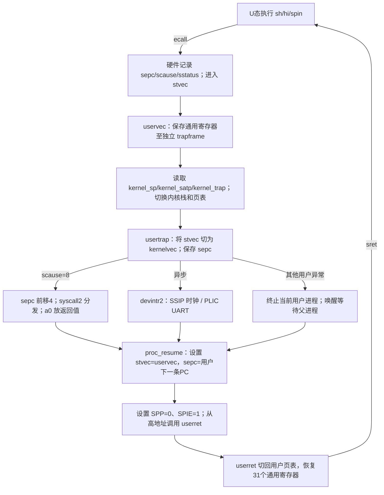

# Lab2 设计笔记：陷入与中断

## 1. 实验目标与个人参数

在自己的 Lab1 代码上实现可交互的单核系统，保留 Lab1 banner。个性化参数从不可修改的 `kernel/course_sid.h` 读取：

| 参数 | 本人值 | 实现位置 |
|---|---:|---|
| LAB2_TICK | 1 | start.c：`100000 * LAB2_TICK` 个 mtime 单位；基本周期约 10ms |
| LAB2_BUF_SEMANTICS | 1 | console2.c：字符一到即可读，不等待换行 |
| LAB2_BUF_SIZE | 64 | console2.c：环形数组容量及取模 |

## 2. 为何提前使用最小页表

课程说明允许 Bare 模式，但预置 user.ld 将程序链接到地址 0，预置 trampoline.S 固定访问高地址 TRAPFRAME；这两处不能直接用 QEMU virt 的物理 RAM 满足。用户已确认采用最小 Sv39 映射，不修改预置代码。

- 内核页表使用 supervisor-only 的 RAM/MMIO 直映和高地址跳板映射。
- 每进程有私有 128KiB 物理数组，映射为用户虚拟区间 `[0, 0x20000)`。
- 初始用户 sp 为 `0x20000`，栈向低地址生长；heap 从 ELF 各分配段末端向上增长，预留顶部 8KiB；不支持缩堆。
- TRAPFRAME 映射到本进程独立、页对齐的 trapframe；无 U 位，用户不能直接访问。
- TRAMPOLINE 映射到同一个预置跳板物理页，内核/用户页表中的虚拟地址一致，且无 U 位。
- 当前用户普通内存统一 RWX；细粒度段权限、guard 页与个人页分配策略属于 Lab3，本轮不宣称完成这些要求。
- 用户指针不直接解引用：`copyin2/copyout2/copystr2` 检查区间，再访问当前进程物理副本，拒绝负长度、溢出地址和内核地址。

## 3. Trap 状态转移全景

x0 永远为零，不需要保存；其他 31 个通用寄存器均由预置汇编保存。trapframe 开头 5 个字段是内核返回信息与用户 epc，ra 位于 40、sp 位于 48、a0 位于 112、t6 位于 280；头文件用编译期断言固定关键偏移。

硬件进入 S 态陷入时：记录原 PC 到 sepc、更新 sstatus 的 SPP/SPIE/SIE、写 scause（及相关 stval）并跳 stvec。硬件不自动切栈，也不替内核保存通用寄存器。跳板先用 sscratch 暂存用户 a0，再用 a0 寻址固定虚拟 TRAPFRAME；最后取回 a0 并存入现场。本包不是把 sp 直接与 sscratch 交换的变体，应按实际源码讲解。

`ecall` 是 4 字节指令，硬件 sepc 指向它本身；正常返回前必须加 4，否则重执行同一请求。中断打断的指令不做此加法。未知调用只返回 -1。

进入 usertrap 后立即将 stvec 改成 kernelvec，避免内核中断误用用户入口破坏现场；返回用户前恢复 uservec。kernelvec 在当前内核栈另保存通用寄存器，kerneltrap 保存/恢复 sepc 与 sstatus，因此能嵌套在阻塞 read/pause 中处理 UART/时钟。

## 4. 时钟、UART 与同步协议

启动仍从 M 态设置 PMP，再进入 S 态。M 定时器使用 CLINT mtime/mtimecmp：机器中断汇编只保存所用临时寄存器、推进 compare、置 SSIP；S 态处理 SSIP 后增加 ticks 并清 pending。机器中断没有被误当作用户 ecall。

UART 接收开启 16550 的接收中断，PLIC 为 IRQ10 设置优先级、S 态使能和阈值。外部中断先 claim，排空 RHR 后 complete。发送保留 Lab1 的轮询式硬件操作；本轮升级的是接收，不虚构中断驱动发送。

生产者是 consoleintr2，消费者是 console_read2。单核采用关 S 态中断作为互斥：用户 trap 已清 SIE，队列检查/修改均在 SIE=0 下；M 态定时器只置中断位，不碰队列。无多核自旋锁，后续多核必须重构。

| 输入缓冲状态/事件 | 处理 |
|---|---|
| 空，read请求非零长度 | 标记 BLOCKED_IO，在 SIE=0 下 WFI；开中断处理待处理事件，再关中断复查 |
| 字符流收到一个字节 | 放入队列，条件满足；若消费者正在等待，变为 RUNNING 并计一次唤醒 |
| 行缓冲分支尚无换行 | 继续等待；遇换行/EOF或满缓冲后可读，避免超长行永久阻塞 |
| 队列已满 | 丢弃新字节并增加 rx_dropped，不覆盖旧数据，中断不阻塞 |
| Ctrl+C | 标记前台子进程 killed，等待或用户陷入返回边界结束它 |
| Ctrl+D | 作为 EOF 标记，遵循“先交付已有数据，再返回0”的语义 |

状态检查与 WFI 在 SIE=0 下连续完成，避免“检查后中断已处理、随后永久睡眠”的窗口。局部中断源已使能时，待处理中断能使 QEMU 的 WFI 返回；短暂打开 SIE 让 kerneltrap 真正消费它。这里不是完整进程调度式 sleep/wakeup，而是课程允许的单核最简阻塞机制。

## 5. 最简进程生命周期与系统调用

固定 8 个槽，每个槽包含独立用户内存、trapframe、页表和 8KiB 内核栈。生命周期为 FREE → READY → RUNNING；父进程 wait 后 WAITING，子进程运行；读输入可临时 BLOCKED_IO；退出变为 ZOMBIE，等待者取得退出码后回收槽。

`fork` 拷贝全部 128KiB 用户镜像和 trapframe；子返回 a0=0，父返回子 PID。虚拟地址不变，物理副本不同；不需要修正用户栈上的指针。没有 COW。

`wait` 没有子进程返回 -1，有已退出子进程则回收；否则保存用户退出码指针，切换到 READY 的子进程。此处只选择用户现场，不做通用内核栈 swtch；原系统调用已保存于 trapframe，子退出时父亲从 wait 的下一条用户指令恢复。时钟不进行抢占式轮转，因此这不是 Lab4 调度器。父先退出时，READY 子进程由内部收尾器托管（parent=0），使用 reap_owner/pending_reap 记录子树依赖，完成内部 wait 和递归回收后才交付原父退出状态，避免孤儿占满槽及祖先提前返回；这是一种串行化收尾策略，而不是标准多任务 init 并发回收。

`exec` 从预置 `_uprog_table` 按名查找映像，清用户内存、复制平铺字节、设置入口和新栈。预置生成器实际把程序字节夹在相邻表项之间，所以遍历时跳到本项 end 的下一个8字节边界，而不是误把代码当下一个表项。

平铺二进制不保留 ELF entry 和 BSS 长度：`tools/user_metadata.py` 从原 ELF 提取真实入口与分配段末端生成 userentry.h。不能假设 main 永远在地址0，自编 probe 特意有前置辅助函数验证非零入口。预置 sh 把 gets 的换行直接作为名字传给 exec，因此内核规范化末尾行结束符。argv 暂忽略，符合本轮接口许可。

分发表读取 a7 与 a0-a2，a0 返回结果。支持 fork/exit/wait/read/write/exec/getpid/kill/uptime/pause/增长式sbrk/标准描述符close/sync；不具备的文件系统等调用统一返回 -1。读写只接受对应标准描述符并检查用户范围。用户异常只结束该进程，内核异常打印诊断并停住，二者不混淆。

## 6. 预置文件适配而不篡改

1. kernel/trampoline.S 的 trampsec 没有分配/执行标志；构建后对派生 `.o` 设置 alloc/load/code 与4096字节对齐，使它进入 ELF 可装载段。预置汇编和 kernel.ld 原文件不变。
2. Makefile.upgrade 中共享用户库目标不能并发写，因此本轮显式串行化构建；并补齐追加测试程序的生成依赖。
3. 官方 inject_uart.py 等待 `$ ` 且要求 fs.img；保留原样，使用新增 Python 串口驱动适配真实 `sh> ` 与无磁盘环境。
4. 以上矛盾与选择都记录在源码/笔记中，不以“预置文件存在”代替运行验证。

## 7. 验收问答速查

- sepc 为什么加4？系统调用返回要越过 ecall，而中断返回应继续被打断位置。
- 栈在哪里切？uservec 从 trapframe 取 kernel_sp；userret 恢复用户 sp。
- 为什么有两套入口？用户现场保存方式和内核现场保存方式不同，stvec 必须随执行阶段切换。
- 为什么不持有普通锁睡？本轮用单核中断屏蔽保护，等待前没有持有需要中断处理者获取的自旋锁。
- 缓冲改为8字节会怎样？受控少量输入仍可用，消费者停顿时更容易满；满后丢新数据，不能承诺任意速率绝不丢字节。
- 是否完成多核/文件系统/Lab3？没有；这些不属于已确认的 Lab2 交付范围。

实际测试命令与串口结果见 README-Lab2.md 和 tests/results/，不要把源码推断当作实测。
